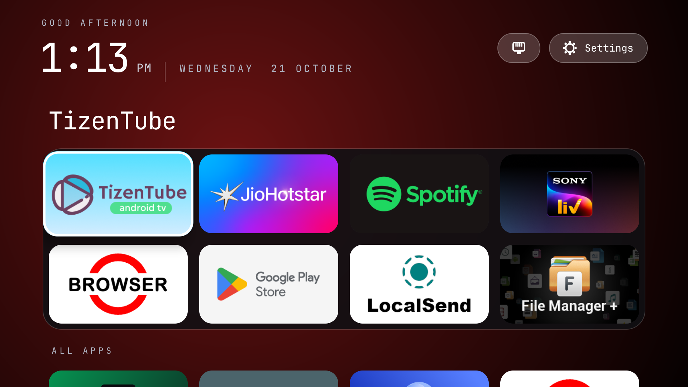
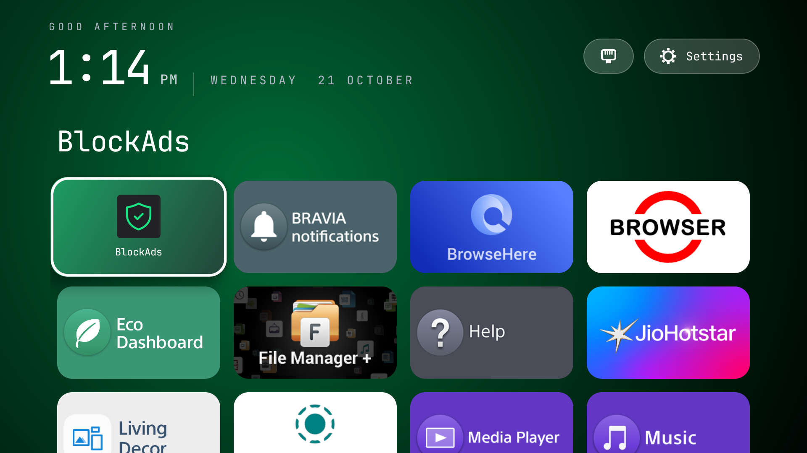

<div align="center">
  

  <h1>Aam Launcher</h1>

  <p><strong>A fast, focus-first home screen for Android TV.</strong></p>
  <p>Your favourite apps up front. Everything else one D-pad press away.</p>

  <p>
    
    
    
    
  </p>
</div>

---

## Overview

Aam Launcher is a lightweight, remote-friendly home screen for Android TV, originally developed and tested on a Sony BRAVIA. It puts frequently used apps first, with a live clock and greeting, a pinned-apps panel, and an **All Apps** grid below it.

The interface is designed around D-pad navigation and keeps the focus on your installed apps rather than recommendation feeds or promotional rows.

<div align="center">
  
</div>

## Screenshots

These screenshots show the launcher running on a TV: the favourites panel and the full All Apps grid.

<table>
  <tr>
    <td align="center" width="50%"><strong>Favourites panel</strong></td>
    <td align="center" width="50%"><strong>All Apps</strong></td>
  </tr>
  <tr>
    <td align="center"></td>
    <td align="center"></td>
  </tr>
</table>

> The screenshot files are stored in `screenshots/fav8.png` and `screenshots/all-apps.png`.

## Features

- **Favourites panel:** Keep frequently used apps in a two-row panel at the top of the screen.
- **All Apps grid:** Browse launchable apps in a four-column grid.
- **TV and standard apps:** Discovers apps exposed through Android TV's Leanback launcher category and the standard launcher category.
- **Remote-first focus:** A visible focus treatment, scale-up on the selected tile, and a large title showing the focused app's name.
- **App-aware accent glow:** The background accent follows the focused app using known brand colours or a colour derived from its icon.
- **Live header:** Time-of-day greeting, clock, date, and a network indicator for Wi-Fi or Ethernet.
- **Settings shortcut:** Open system settings from the home screen.
- **Long-press menu:** Hold OK/Enter on a tile to pin or unpin it, reorder pinned apps, hide an app from All Apps, or restore hidden apps.
- **Remembers your layout:** Pinned and hidden-app selections are stored locally with `SharedPreferences`.
- **Smooth scrolling:** App visuals and tint colours are prepared off the main thread; rows fade as they leave the visible area.

### Default favourites

On first launch, the panel is pre-filled with the following apps when they are installed. You can customise the selection from the long-press menu.

TizenTube · JioHotstar · Spotify · SonyLIV · Browser · Play Store · LocalSend · File Manager+

## Getting started

### Requirements

- An Android TV device or emulator. The configured minimum SDK is Android 12 / API 31.
- Android Studio and the Android SDK, or a compatible command-line Android build environment.
- JDK 17 for the configured Java compile options.
- ADB (`platform-tools`) for installing and launching the app on a connected device.

### Clone the repository

```bash
git clone https://github.com/beingRonit/aam-launcher.git
cd aam-launcher
```

### Build

On Windows PowerShell:

```powershell
.\gradlew.bat assembleDebug
```

On macOS/Linux:

```bash
./gradlew assembleDebug
```

The debug APK is generated at:

```text
app/build/outputs/apk/debug/app-debug.apk
```

### Install on Android TV

Enable Developer Options and USB or network debugging on the TV. If using ADB over your local network, connect to the TV first:

```bash
adb connect <TV_IP_ADDRESS>:5555
adb devices
```

Install the APK:

```bash
adb install -r app/build/outputs/apk/debug/app-debug.apk
```

Launch Aam Launcher explicitly:

```bash
adb shell am start -n com.litehome.aamlauncher/com.litehome.bravialauncher.MainActivity
```

To use it as the Home app, press **Home** on the remote and choose Aam Launcher if Android offers a launcher picker. Some TV firmware may restrict changing the default Home app; available settings vary by device.

> **Package details:** The installed application ID is `com.litehome.aamlauncher`. The Java activity remains in the `com.litehome.bravialauncher` namespace, so the explicit component above uses both names.

### Capture a screenshot for debugging

On Windows PowerShell:

```powershell
$adb = "$env:LOCALAPPDATA\Android\platform-tools\adb.exe"
& $adb shell screencap -p /sdcard/aam.png
& $adb pull /sdcard/aam.png .\aam.png
```

## Remote controls

| Remote button | Action |
| --- | --- |
| D-pad | Move focus between tiles |
| OK / Enter | Launch the focused app |
| Long-press OK / Enter | Open the pin, reorder, and hide menu |
| Back | Return focus to the first tile |

## Project structure

```text
aam-launcher/
├── app/
│   ├── build.gradle.kts
│   └── src/main/
│       ├── AndroidManifest.xml
│       ├── assets/fonts/
│       ├── java/com/litehome/bravialauncher/
│       │   └── MainActivity.java
│       └── res/
│           ├── drawable-nodpi/
│           │   ├── aam_banner.png
│           │   └── aam_icon.png
│           ├── mipmap-*/
│           └── values/
├── screenshots/
│   ├── fav8.png
│   └── all-apps.png
├── gradle/wrapper/
├── build.gradle.kts
├── gradle.properties
├── gradlew
├── gradlew.bat
└── settings.gradle.kts
```

## How it works

- **Single activity:** `MainActivity` builds the interface programmatically in Java; the main screen does not use XML layouts.
- **RecyclerView grid:** A `RecyclerView` with a `GridLayoutManager` displays the favourites panel, All Apps heading, and app tiles. Span-size handling accommodates full-width rows.
- **Remote focus handling:** Focus callbacks and layout/scroll logic keep D-pad navigation predictable and update the focused-app title and accent.
- **Custom drawing:** An item decoration draws the favourites panel and fades it as the grid scrolls away. Rows near the top edge also fade based on their visible portion.
- **Background preparation:** App icons, banners, and tint colours are prepared on a background executor to help keep scrolling responsive.

## Customising

The following settings are defined in `MainActivity.java`:

| Setting | What it controls |
| --- | --- |
| Default pinned-apps setup in the preferences loader | Initial favourites |
| `DEFAULT_LABELS` | Friendly names for apps |
| `KNOWN_TINTS` | Known accent colours per app |
| `MAX_PINNED` | Maximum number of pinned apps |
| `COLUMNS` | Number of grid columns |
| `TILE_RADIUS_DP` | Tile corner radius |

## Contributing

Issues and pull requests are welcome. For visual or animation changes, include a screenshot or a short screen recording from a real TV when possible; emulator frame timing can differ from TV hardware.

1. Fork the repository.
2. Create a feature branch: `git checkout -b feature/my-change`.
3. Commit your changes and push the branch.
4. Open a pull request.

## Author

Made by [Ronit](https://github.com/beingRonit).

## License

No `LICENSE` file is currently included. Until a license is added, don't assume the project is available for unrestricted reuse or redistribution.

---

<div align="center">
  <sub>Built for the big screen. 📺</sub>
</div>
